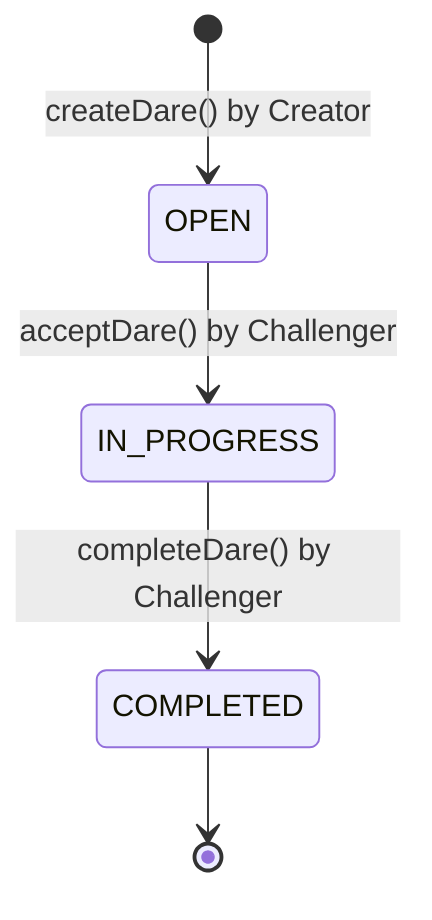

# DareMe — Whitepaper & Project Overview
**Tagline:** Drop a dare. Take the challenge. Prove yourself.  
**Network:** Botchain Testnet (Chain ID: `968`)  
**Contract Address:** `0x1f880a81C15E362CE39e300CbcF4fA514fE72fBe`  
**Explorer:** [https://scan.bohr.life/address/0x1f880a81C15E362CE39e300CbcF4fA514fE72fBe#code](https://scan.bohr.life/address/0x1f880a81C15E362CE39e300CbcF4fA514fE72fBe#code)  
**Repository:** [https://github.com/liljhnxn/dareme](https://github.com/liljhnxn/dareme)  

---

## 1. Executive Summary

**DareMe** is a decentralized, peer-to-peer social challenge protocol designed specifically for **Botchain Testnet**. It enables users to post open challenges ("dares"), accept challenges posted by others, and self-report completion directly on-chain. 

DareMe removes the friction, censorship, and data-mining of traditional Web2 challenge platforms by relying entirely on verifiable smart contracts, requiring no centralized database, traditional accounts, or third-party custody.

---

## 2. Problem Statement

1. **Centralization & Censorship:** Web2 social challenge platforms rely on centralized databases, ad-driven algorithms, and opaque moderation policies.
2. **Custody & Privacy Risks:** Most social apps force users to create centralized accounts tied to personal phone numbers, emails, and identity graphs.
3. **Overcomplicated Web3 Apps:** Many decentralized applications introduce unnecessary tokens, complex staking mechanisms, and volatile financial incentives that detract from pure user engagement and community fun.

---

## 3. The DareMe Solution

DareMe offers a clean, zero-custody, minimal Web3 dApp centered around community engagement:

- **100% On-Chain State:** Every dare, participation, and completion timestamp lives immutably on the Botchain ledger.
- **Pure Wallet Identity:** Users interact natively with their MetaMask wallet address. No passwords, KYC, or private data collection.
- **Fair Participation Mechanics:** Custom smart contract logic guarantees that creators cannot accept their own dares and dares cannot be claimed simultaneously by multiple participants.
- **Lightweight & Accessible:** No tokens, speculative tokens, or payment barriers. Simple testnet gas (`tBOT`) powers real-time interactions.

---

## 4. System Architecture & Lifecycle

### Dare Lifecycle:
1. **Creation (`createDare`):** A creator submits a dare with a title (max 100 characters), description (max 500 characters), and category (`Fun`, `Knowledge`, `Gaming`, or `Fitness`). Dare status initializes as `OPEN`.
2. **Acceptance (`acceptDare`):** Any connected wallet (other than the creator) can accept an open dare. The contract updates the participant address and transitions status to `IN_PROGRESS`.
3. **Completion (`completeDare`):** The assigned challenger reports task completion. The contract records the block timestamp and updates the status to `COMPLETED`.

---

## 5. Technical Specifications

- **Smart Contract:** Solidity `0.8.24` (`DareMe.sol`) optimized with 200 compiler runs.
- **Frontend Stack:** Next.js (App Router), React 18, TypeScript, Tailwind CSS.
- **Web3 Connectivity:** Wagmi v2, Viem v2, MetaMask injected provider.
- **Network Parameters:**
  - Chain: Botchain Testnet
  - Chain ID: `968`
  - RPC URL: `https://rpc.bohr.life`
  - Explorer: `https://scan.bohr.life`
  - Priority Fee Floor: `20 Gwei` (DareMe handles 25 Gwei automatically)

---

## 6. Smart Contract Security & Integrity

- **Spam Prevention:** Strict text length limits prevent transaction bloat and minimize gas expenditure.
- **Reentrancy & Custody Immunity:** The contract neither accepts nor holds funds, eliminating exploit vectors related to monetary drainage.
- **Access Control:** Custom errors (`CreatorCannotAccept`, `DareNotOpen`, `OnlyParticipantCanComplete`, `DareNotInProgress`) enforce strict caller checks at the bytecode level.
- **Transparent Self-Reporting:** DareMe explicitly informs users that completion is self-reported, establishing transparent expectations.

---

## 7. Roadmap & Future Vision

- **Phase 1 (Current):** Single-page dApp, open peer-to-peer dares, verified contract deployment on Botchain Testnet.
- **Phase 2 (Community & Reputation):** On-chain badges / Soulbound proof-of-challenge tokens (SBTs) for completed dares.
- **Phase 3 (Multi-participant & Voting):** Optional group challenge modes with community upvoting on completed dares.

